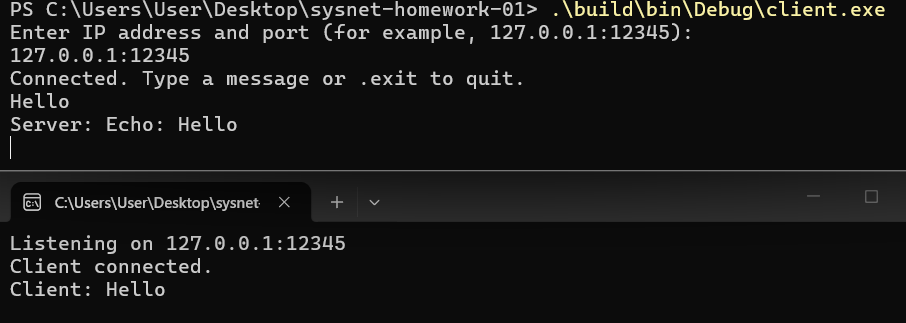
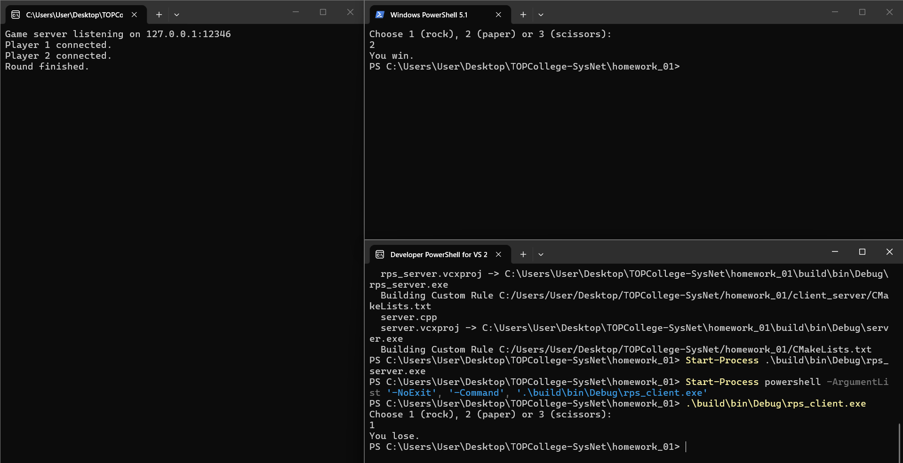
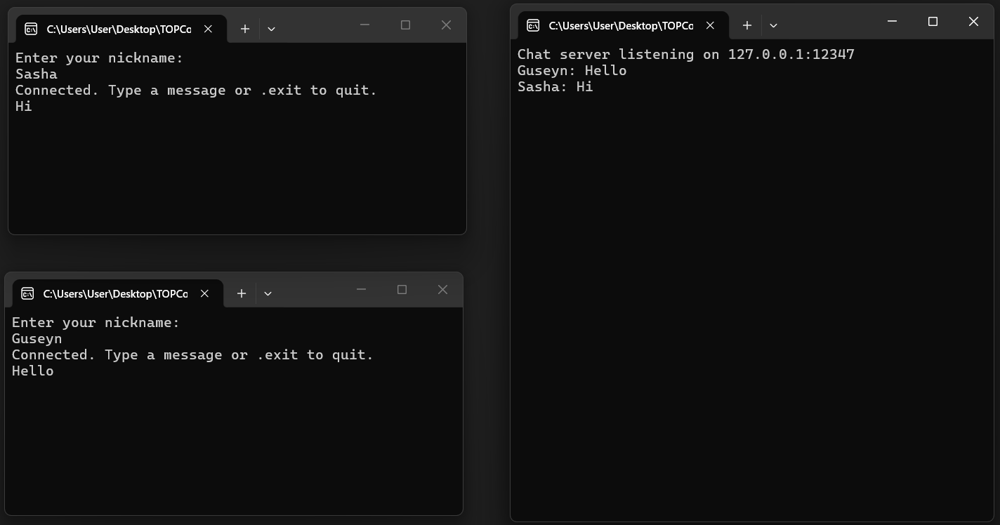
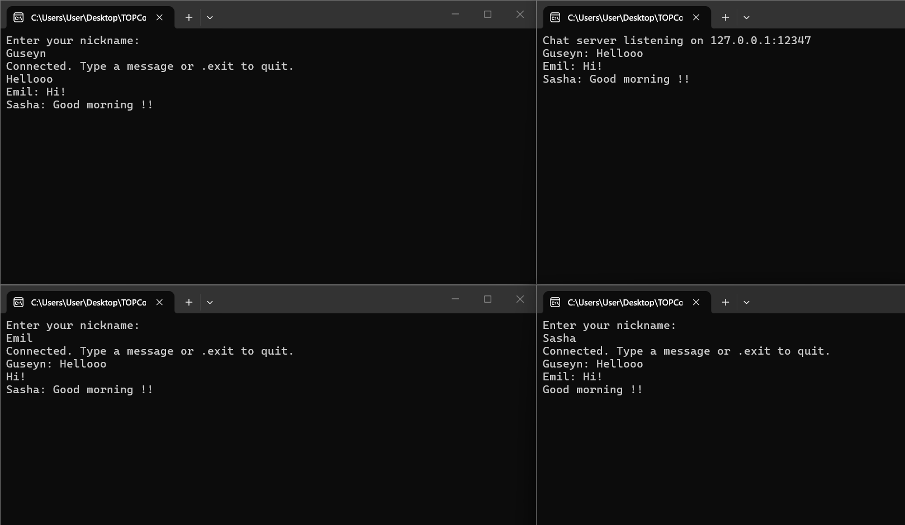

# Сетевое программирование. TCP-сокеты, игра и чат

Учебный репозиторий по сетевому программированию на C++20. TCP-обмен, игра и чат используют общую статическую библиотеку `tcp_socket`.

Первое задание основано на учебном примере. [TOPCollege-SysNet](https://github.com/worriedlemon/TOPCollege-SysNet)

| Задание | Сервер | Клиент | Адрес |
| --- | --- | --- | --- |
| TCP-обмен сообщениями | `server` | `client` | `127.0.0.1:12345` |
| Камень, ножницы, бумага | `rps_server` | `rps_client` | `127.0.0.1:12346` |
| Чат | `chat_server` | `chat_client` | `127.0.0.1:12347` |

## Реализация сокетов

- `TcpSocket` оборачивает системные операции с TCP-сокетом и автоматически закрывает дескриптор при уничтожении объекта по принципу RAII.
- `TcpClient` устанавливает соединение через `Connect`. Методы `Send` и `Receive` передают данные в виде `std::string`.
- `TcpServer` прослушивает порт. Метод `Accept` сохраняет соединение в сервере, а `AcceptClient` возвращает отдельный объект для каждого принятого подключения.

Клиент и сервер приватно наследуют `TcpSocket` и открывают нужные унаследованные методы через `using`. Символ новой строки (`\n`) отмечает конец сообщения в TCP-потоке.

## Сборка и запуск

Выполните команды из корня репозитория. Требуются CMake и компилятор с поддержкой C++20.

### Windows · Visual Studio 2022

В **Developer PowerShell for VS 2022** выполните:

```powershell
cmake -S . -B build -G "Visual Studio 17 2022" -A x64
cmake --build build --config Debug
```

Исполняемые файлы находятся в `build\bin\Debug`. Их можно запустить из отдельных терминалов. Для запуска из Visual Studio откройте папку репозитория, выберите нужный файл `.exe` в списке элементов запуска и нажмите **Ctrl+F5**.

### Linux

```bash
cmake -S . -B build
cmake --build build
```

Исполняемые файлы находятся в `build/bin`.

## Результаты проверки на Windows

Для каждого примера сначала запустите сервер, затем клиенты в отдельных окнах.

### 1. TCP-обмен сообщениями

В клиенте введите адрес `127.0.0.1:12345` и отправьте `Hello`. Сервер выводит `Client: Hello`, а клиент получает `Server: Echo: Hello`.



### 2. Камень, ножницы, бумага

Запустите два экземпляра `rps_client`. Каждый игрок выбирает `1` (камень), `2` (бумага) или `3` (ножницы). Сервер сравнивает ходы и отправляет результат каждому игроку. После раунда он ждёт следующую пару.

На скриншоте бумага (`2`) побеждает камень (`1`). Игроки получают `You win.` и `You lose.` соответственно.



### 3. Чат с выводом на сервере

В первой версии чата сервер обслуживал подключения в отдельных потоках и выводил сообщения в формате `никнейм: сообщение`. На скриншоте два клиента отправили сообщения, а сервер вывел `Guseyn: Hello` и `Sasha: Hi`.



### 4. Чат с рассылкой сообщений

Сервер хранит список подключений и рассылает сообщения всем остальным клиентам. Клиент принимает и выводит сообщения в отдельном потоке, пока пользователь может вводить новые.

Для проверки запустите `chat_server` и три экземпляра `chat_client`. Введите разные никнеймы и отправьте по сообщению из каждого окна. Сервер покажет все три сообщения, а каждый клиент получит по два сообщения с никнеймами собеседников.



Для выхода из клиента TCP-обмена или чата введите `.exit`. Сервер игры или чата можно остановить через **Ctrl+C**.
